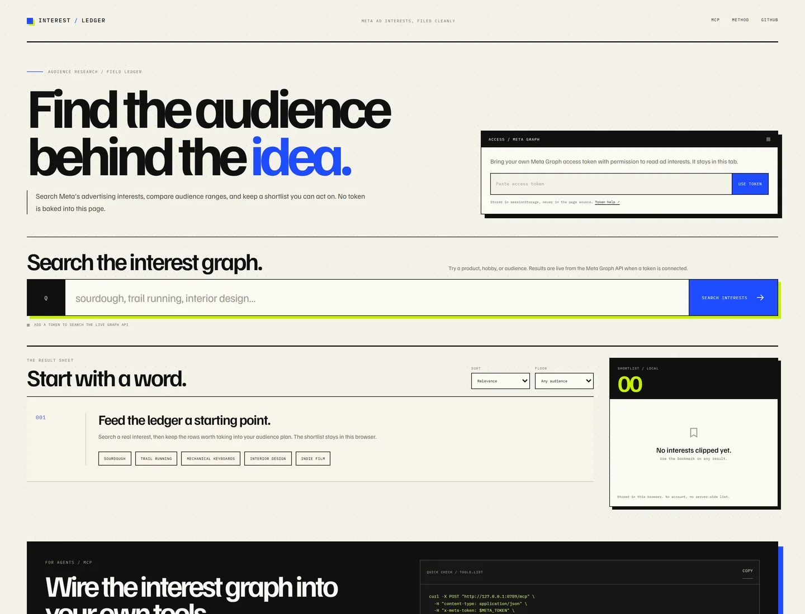
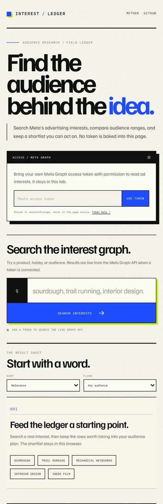

<div align="center">
  
  <h1>Interest Ledger</h1>
  <p><em>Find the audience behind the idea.</em></p>
  <p><strong>A Meta ad-interest search desk for the moment before a campaign brief exists.</strong><br />
  Search interest names and audience ranges, keep a shortlist, export the evidence, and ask the same question over MCP.<br />
  Bring your own Graph token or configure one on the server. No fake results are bundled.</p>

  <p>
    <a href="https://meta-interest-finder.vercel.app/"></a>
    <a href="https://meta-interest-finder.pages.dev/"></a>
    <a href="LICENSE"></a>
    <a href="https://github.com/lab1207/Meta-Interest-Finder/actions/workflows/ci.yml"></a>
    <a href="https://github.com/lab1207/Meta-Interest-Finder/stargazers"></a>
  </p>

  <p><sub>If this saves you a round of ad-platform archaeology, a star helps.</sub></p>
</div>

<br />



<p align="center">
  
</p>

<p align="center"><sub>The live app before a Graph token is added. The empty state is honest: no search data is bundled.</sub></p>

## The idea

Meta's ad-interest graph is useful when you have a rough audience in mind but not yet a campaign structure. The names and audience bounds are buried in a permissioned Graph API, and the surrounding tools often turn a rough search into a black box.

Interest Ledger keeps the desk simple:

1. Search a word or phrase.
2. Read the interest name, hierarchy path, and audience range.
3. Keep the useful rows in a shortlist.
4. Export the shortlist as CSV, or call the same search through MCP.

It is a research aid, not a prediction machine. Audience bounds are the estimates Meta returns; they are not a promise of reach, targeting eligibility, or campaign performance.

## What it does

- **Search Meta interests** with the Graph API `adinterest` search.
- **Read the context**: name, path, numeric interest ID, and audience lower/upper bounds.
- **Sort and filter** by relevance, name, or audience; filter to a minimum audience size.
- **Build a shortlist** that persists in the browser's `localStorage` on that device.
- **Export CSV** for a brief, a media plan, or a spreadsheet; copy visible IDs in one click.
- **Paginate** through Graph results with a cursor.
- **Ask over MCP** at `/mcp` with a `search_meta_interests` tool for agent workflows.
- **Choose an access mode**: a token entered for the current tab, or a server-side `META_TOKEN` configured in Pages.

## Run it locally

```bash
npm install
npm run dev
```

The Vite server is enough to work on the interface. To exercise `/api/*` and `/mcp`, use the Vercel CLI:

```bash
npm install
npx vercel dev
```

`vercel dev` serves the Vite app, the `api/` functions, and the `/mcp` rewrite. Copy `.env.example` to `.env.local` and add `META_TOKEN` if you want to test server-token mode locally. The same build also runs on the optional Cloudflare Pages runtime:

```bash
npm run build
npx wrangler pages dev dist
```

Open the local URL printed by the CLI. The access panel reports whether the runtime has a server token.

## Access modes

### 1. Browser token (BYOK)

Paste a Meta Graph access token into the access panel and choose **Use token**. It is stored in `sessionStorage` for that browser tab, sent only to this app's own `/api/interests` function, and forwarded to Meta. It is not written to a cookie, `localStorage`, a log, or the repository.

When Meta rejects the token, the app clears it and asks for another one. The token is never rendered into the page's HTML.

### 2. Server token

If the deployment has a `META_TOKEN` environment variable, the access panel reports a server token and the browser does not need to send one.

For Vercel, add `META_TOKEN` under **Project Settings → Environment Variables** for Production, Preview, and Development, then redeploy. For the optional Cloudflare mirror:

```bash
npx wrangler pages secret put META_TOKEN --project-name meta-interest-finder
```

The server token is never sent to the browser. A public deployment using a server token lets any visitor search with that token, so add access control or rate limiting if that is not the desired policy. The existing Vercel project can keep using Vercel Authentication or its own access rules.

A token needs Graph API access to the ad interest search. Permissions and app review rules are controlled by Meta and can change. If a token is missing or lacks access, the app shows the error instead of inventing results.

## Endpoints

| Method | Path | Purpose |
| --- | --- | --- |
| `GET` | `/api/status` | Reports whether a server token is configured and which Graph version is used. |
| `GET` | `/api/interests?q=sourdough&limit=50&after=...` | Searches the Graph API. Uses `META_TOKEN` if present, otherwise `X-Meta-Token`. |
| `POST` | `/mcp` | Stateless JSON-RPC 2.0 endpoint with `initialize`, `tools/list`, and `tools/call`. |

### API example

```bash
curl -s 'https://meta-interest-finder.vercel.app/api/interests?q=sourdough&limit=5' \
  -H "x-meta-token: $META_TOKEN"
```

### MCP example

```bash
curl -s https://meta-interest-finder.vercel.app/mcp \
  -H 'content-type: application/json' \
  -d '{
    "jsonrpc": "2.0",
    "id": 1,
    "method": "tools/call",
    "params": {
      "name": "search_meta_interests",
      "arguments": { "q": "sourdough", "limit": 5 }
    }
  }' \
  -H "x-meta-token: $META_TOKEN"
```

Omit `X-Meta-Token` when the server secret is configured. The MCP endpoint is intended for server-side clients; it does not ship a browser session or an access token of its own.

## How it works

- **Frontend:** React + Vite, with a deliberately editorial search sheet, a token panel, and a shortlist rail. Shortlist state is local to the browser.
- **Vercel Functions:** `api/interests.js` validates the query and token, calls `https://graph.facebook.com/v20.0/search` with `type=adinterest`, and normalizes the response. `api/status.js` reports `serverToken` without exposing the secret, and `api/mcp.js` implements the JSON-RPC methods.
- **Cloudflare Pages Functions:** `functions/` mirrors the same endpoints for the optional Cloudflare deployment.
- **Routing:** `vercel.json` rewrites `/mcp` to `/api/mcp`; the static build is served from `dist/`.
- **Graph helper:** the request and normalization logic lives in `api/_lib.js` for Vercel and `functions/_lib.ts` for Cloudflare.

The Graph token is only used in the function or the request header. The browser never receives a server token.

## Deploy

### Vercel (primary)

1. Import the repository into Vercel. The included `vercel.json` sets the build command, output directory, and `/mcp` rewrite.
2. Add `META_TOKEN` as an environment variable if you want server-token mode. Leave it unset for BYOK-only.
3. Deploy. Vercel serves the Vite build and the `api/` functions on the same domain.

### Cloudflare Pages (optional)

```bash
npm run build
npx wrangler pages deploy dist --project-name meta-interest-finder
```

Set `META_TOKEN` as a Pages secret if you want server-token mode. The `functions/` directory is picked up automatically. The Cloudflare mirror is useful when you want a public, unprotected demo; the Vercel project can keep its existing access settings.

## Privacy and security notes

- No account system, analytics, or server-side interest database.
- Browser tokens live in `sessionStorage` for the tab; closing the tab clears them.
- Server tokens belong in Vercel environment variables or Cloudflare Pages secrets, never in `vercel.json`, `wrangler.toml`, `.env` files, or commits.
- The Graph API receives the search query and token over HTTPS.
- The interface uses Google Fonts; the font request is the only third-party browser request in the default app.
- If you run a public server-token deployment, protect it as you would any public API. A token can be abused even when it is not visible in the browser.

## Limits

- Meta controls the Graph API version, permissions, rate limits, and the meaning of audience bounds.
- Results depend entirely on the token's access. There is no fallback dataset.
- The app does not save searches or create campaigns; it is a research surface.
- Audience values are estimates and should not be treated as exact reach.
- `v20.0` is pinned in `api/_lib.js` and `functions/_lib.ts`; update both deliberately when Meta deprecates a version.

## Contributing

Small, focused improvements are welcome. Please read [CONTRIBUTING.md](CONTRIBUTING.md) and [SECURITY.md](SECURITY.md) first.

The useful checks are:

```bash
npm ci
npm run build
npm run check:api
```

Never commit a real Meta token, a screenshot containing one, or a request log with an unredacted token.

## License

GPL-3.0-or-later. See [LICENSE](LICENSE).
